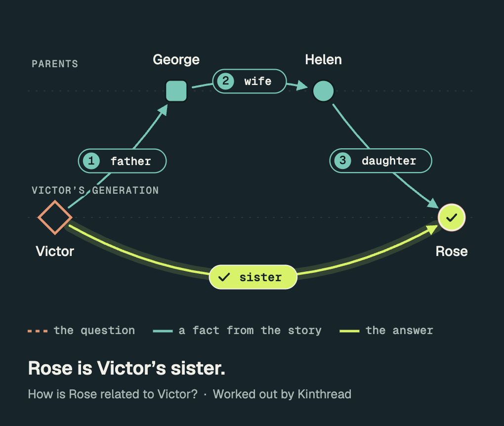
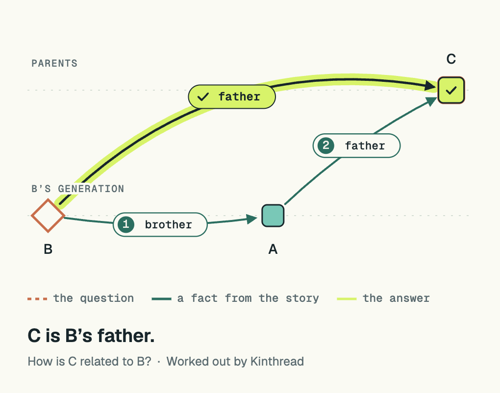

# Kinthread

**Blood-relation puzzles, solved step by step.**

Kinthread reads a short family story, or a textbook question like *"A is the brother of B. C is the father of A. How
is C related to B?"*, and works out how two people are related. It shows the working the way you would write it on
paper: one fact at a time, drawn as a family tree, ending in the answer.

The AI behind it was written and trained from scratch: a 13M-parameter transformer that reasons about relationships
and a 5.1M-parameter model that finds names. Both run **entirely in your browser**. Your story never leaves your
device; there is no server, account or API key.

<p align="center">
  
  
</p>

<p align="center"><sub>Maps saved with the site's own Download button: a story in the dark theme, and a pasted exam question in the light theme.</sub></p>

---

## Contents

- [What it does](#what-it-does)
- [How it works](#how-it-works)
- [Running it locally](#running-it-locally)
- [Project structure](#project-structure)
- [Testing](#testing)
- [Deploying](#deploying)
- [Performance](#performance)
- [Browser support](#browser-support)
- [Limits](#limits)
- [Related](#related)
- [License](#license)

## What it does

1. **Write a family story**, or paste an exam question as it is. Kinthread finds the question ("How is C related to
   B?", "What is C to B?", "C is related to B as?"), ignores multiple-choice options, and treats single letters as
   names.
2. **Pick two people.** The question itself is the picker, *"How is [ ] related to [ ]?"*: tap a blank, then a name.
   As soon as both blanks are filled, it solves.
3. **See how they're related.** The map rebuilds as a family tree, with parents above and children below, and plays
   the reasoning one step at a time:
   - **copper** for the question: a dashed arrow with a "?";
   - **teal** for facts from the story, numbered in reasoning order, each quoted from the sentence it came from;
   - **lime** for the answer, the arrow that replaces the question.

   People are drawn as in biology pedigree charts: squares are male, circles female, and a diamond means the story
   never says. A caption narrates each step ("So Helen is Victor's father's wife, which makes Helen Victor's mother"),
   and you can pause, step back, or jump to the answer.

Kinthread also:

- **saves the map as an image** (PNG) for notes or sharing, made on the device;
- **says when it can't tell** rather than guessing: unrelated people get "no family link", and low-confidence answers
  are labelled a best guess;
- **checks itself:** fixed kinship rules ("a father's wife is a mother") recompute the answer from the model's own
  steps and flag any disagreement;
- **works offline** after the first visit, in a dark or light theme.

## How it works

```text
your story ──► name model ──► names become entity ids (@0, @1, …)
                                   │
                                   ▼
               relation transformer writes the chain of facts
               ("@0 father @1", "@1 wife @2", "@2 daughter @3")
               with a constrained beam search, then the answer
                                   │
                                   ▼
       kinship rules re-check the chain ──► worked map, step by step
```

- **Names to ids.** Before the relation model reads the story, every name becomes an entity id, so it learns
  relationships from the wording ("her son", "his sister"), not from what names usually mean.
- **Chain of thought.** The model writes the family facts along the path from one person to the other before
  answering. The search may only pick relation words and people that appear in the story, and a step checker,
  trained on deliberately wrong chains, lowers the weight of facts the story doesn't state.
- **Knowing when to stop.** If the two people are never mentioned together, or through people who are, it answers
  that the story doesn't link them, without running the model.
- **In the browser.** Both models run in a Web Worker on a small engine written in C and compiled to WebAssembly,
  with SIMD and several threads when the browser allows. Weights are the original 32-bit floats, not quantized, and
  outputs match the PyTorch reference to within 1.5 × 10⁻⁵. Every model file is checked against a SHA-256 checksum
  before it is stored, and again (CRC-32) each time it loads.

The site's *How it works* and *Build log* pages go deeper, including how the models were trained and evaluated.

## Running it locally

Requirements: Node.js 20.11 or newer, and the model files (see below).

```bash
git clone https://github.com/ArAnirudh2901/Kinthread.git
cd Kinthread
npm install
npm run dev          # http://localhost:3000
```

### Model files

The runtime and weights are not stored in this repo. `npm run sync`, which runs automatically before `dev` and
`build`, copies them from the model project
[LLM-From-Scratch](https://github.com/ArAnirudh2901/LLM-From-Scratch) (`2_Training_Tiny_LLM/web`). It checks every
file against that project's `model_manifest.json` and puts them in hashed folders (`public/r/<hash>/`,
`public/m/<hash>/`), so a new model can never be mixed with old code.

By default it looks for that project at `../../Generative_AI/LLM_from_Scratch/2_Training_Tiny_LLM`. Point
`KINSHIP_SRC` at your copy if it lives elsewhere:

```bash
KINSHIP_SRC=/path/to/LLM-From-Scratch/2_Training_Tiny_LLM npm run dev
```

> The trained weights (`web/model/*.gz`, about 64 MB) are not published yet; they come from that project's
> `export_web.py`. Without them there is no model to sync, and the model tests are skipped.

### Commands

| Command | What it does |
| --- | --- |
| `npm run dev` | development server (single-threaded: the dev server can't send the isolation headers) |
| `npm run build` | sync, then a static export to `out/`, then `postbuild`: `_headers`, per-page CSP, service worker |
| `npm run preview` | serves `out/` with Cloudflare's runtime and headers at http://localhost:8788 |
| `npm test` | unit tests, plus model tests when the model files are present |
| `npm run check` | lint + tests + build |

## Project structure

```text
src/
  app/                    pages: home, how-it-works, limits, build-log (Next.js App Router, static export)
  components/
    workbench/            step 1 story editor and examples; step 2 question picker; Solve button
    map/                  step 3: live map, worked solution, step caption and controls, results, model loading
    home/, layout/, content/, three/, brand/
  lib/
    exam.js               exam-question input: finds the question, letters as names, rewording for the model
    relations.js          kinship composition rules ("father's wife" = mother) and evidence lookup
    worked.js             the worked answer as sentences
    solution-layout.js    family-tree layout by generation, collision-free labels and answer arc
    graph/engine.js       force layout for the live map (one GSAP ticker callback)
    export-image.js       map to PNG, with fonts and styles inlined
    gl/constellation.js   hero 3D scene in raw WebGL
    model/client.js       talks to the worker; asks before the download on phones and data saver
runtime/
  worker.js               inference worker: model cache, checksums, both models
  sw.js                   service worker template (offline shell)
scripts/                  sync-runtime.mjs (model files), postbuild.mjs (headers, CSP, service worker)
tests/                    node tests (story, rules, layout, exam input, force layout, real model)
tools/                    WebGPU benchmark, browser test harness
```

`AGENTS.md` is the maintainer's handbook: decisions, constraints and open items, kept current for anyone (or any AI
agent) picking up the work.

## Testing

```bash
npm run check
```

- **Unit tests:** the story reducer, kinship rules, exam-question parsing, force layout, and the solution layout.
  The layout test checks 735 chain shapes at phone and desktop widths for overlapping labels.
- **Model tests** run the real WebAssembly runtime in Node: checksums of every model part, the outcome of every
  example on the site, and exam-style questions.
- **Browser harness** (`tools/harness/`): `node tools/harness/server.mjs` serves the build with production headers;
  `/__solve.html` drives every example at desktop and phone widths and checks for overlaps, step controls and the
  light theme; `/__export.html` checks the image download. Results go to `tools/harness/result.jsonl`.

## Deploying

The site is a static folder (`out/`), built for Cloudflare Pages. The model files are not in git, so deploy by
direct upload from a machine that has them:

```bash
npx wrangler whoami                     # make sure it is the account that should own the site
npm run build
npx wrangler pages deploy out --project-name kinthread
```

Set `SITE_URL` at build time (for example `SITE_URL=https://kinthread.pages.dev npm run build`) so link previews
use the right domain.

The build already handles:

- **Threads:** `_headers` sends `Cross-Origin-Opener-Policy: same-origin` and
  `Cross-Origin-Embedder-Policy: require-corp`, which multi-threaded WebAssembly needs. Without them the
  single-threaded engine runs automatically, about 2× slower.
- **File limits:** weights are split into parts of at most 16 MiB (Cloudflare allows 25 MiB per file).
- **Caching:** hashed folders are immutable for a year; pages and the service worker revalidate.
- **Security:** each page carries a Content-Security-Policy with the exact hashes of its inline scripts, plus
  `X-Frame-Options: DENY`.

## Performance

- About **26 ms per question** on an Apple M2 in Chrome (relaxed SIMD, 4 threads). The matrix-multiply tiles and the
  thread count are tuned on each device when the model loads.
- **One-time download** of 63.9 MB; later visits load from the device in about a second. Phones and data-saver
  connections are asked before the download starts.
- **WebAssembly, not WebGPU:** `tools/bench-webgpu.html` runs the model's real per-step workload both ways. On an
  M2, a WebGPU step took 5–17 ms against 1.6–1.9 ms for WebAssembly, plus about 0.9 s of GPU setup, because beam
  search reads results back after every small step.
- Animation runs on GSAP with transforms and opacity only; the live map sleeps when settled, and the 3D scene pauses
  off screen and is loaded after the page is interactive.

## Browser support

Chrome and Edge 80+, Firefox 114+, Safari 15+. The page picks the fastest engine the browser supports (relaxed SIMD,
SIMD or scalar, with or without threads). Tested in Chrome and Safari on macOS, at widths from 320 to 1440 px.

## Limits

- **English stories with named people**, written in the third person ("Ashley's daughter Lillian…", not "my mom").
- **About 280 words** per story.
- **Eighteen relationships**: parents, children, siblings, grandparents, grandchildren, uncles and aunts, nephews and
  nieces, and in-laws. Short chains of two to four steps are the most reliable.
- **Exam formats not supported yet:** spoken-clue puzzles ("Pointing to a photograph, A said…") and coded relations
  ("A + B means…"). Long "X is the son of Y" chains often come back as a best guess.
- **Friends and coworkers** are the hardest case: the model can mistake them for family.

The site's *Limits & tips* page explains each one, with examples.

## Related

- [LLM-From-Scratch](https://github.com/ArAnirudh2901/LLM-From-Scratch): the transformer, training code and browser
  engine behind Kinthread.

## License

[Apache License 2.0](LICENSE).
